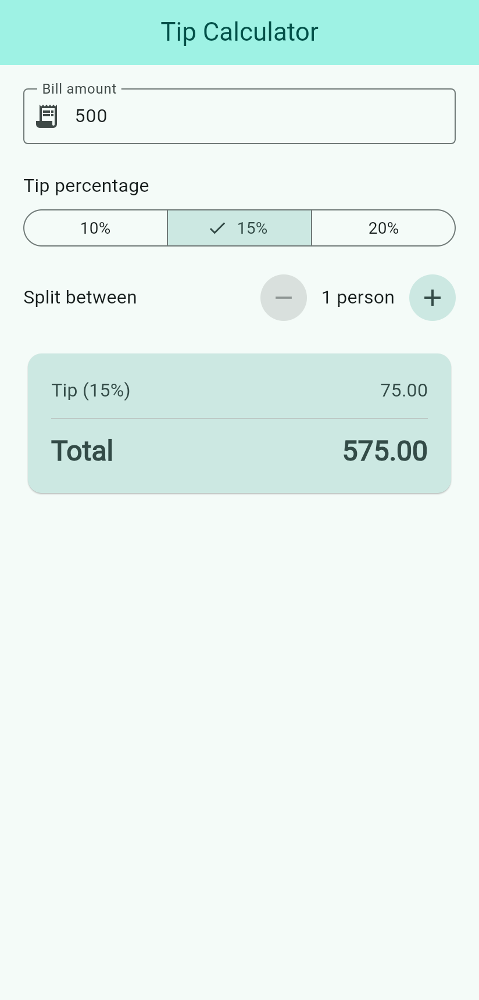

# Tip Calculator

**Name:** Gerald Bello ([@geraldbello0208-boop](https://github.com/geraldbello0208-boop))
**Course:** MOBPROG | Mobile App Development (Flutter), 2nd Term, A.Y. 2026-2027
**Activity:** Laboratory Exercise 01b, Hello Flutter: Tip Calculator

A Flutter app that computes the tip and the total of a bill as you type, with 10%, 15%, and 20% tip options and a Material 3 theme.

## Screenshot



## Features

- Bill amount `TextField` with a numeric keyboard
- `SegmentedButton<int>` for 10%, 15% (default), and 20%
- Tip and total update immediately (`setState`) and always show two decimals
- Empty or invalid input (for example `abc`) shows "Enter a valid amount" instead of crashing
- Material 3 theme built with `ColorScheme.fromSeed` (light and dark)
- Extension challenge: split the bill between N people and see the amount per person; the chosen percentage is remembered while the app is open

| Input | Tip | Total |
|---|---|---|
| Bill 500, 15% | 75.00 | 575.00 |
| Bill abc | Enter a valid amount | |

## Run it

```bash
flutter pub get
flutter run            # or: flutter run -d chrome
flutter analyze        # No issues found
flutter test           # unit tests for computeTip/parseBill + widget tests
```

The app code is in [`lib/main.dart`](lib/main.dart) and the tests are in [`test/widget_test.dart`](test/widget_test.dart).
